# Testing Analog Spiking Neurons: Finding the Defects the Spikes Hide

**Authors:** Tushar Dudeja, Vishal Gupta, Vellore Institute of Technology (VIT)
**Tools:** ngspice 41 + open GF180MCU PDK, Synopsys PrimeSim HSPICE + TSMC 65 nm models, Python (scikit-learn)

Neuromorphic chips contain thousands of small analog neuron circuits, and every one
of them has to be tested after manufacturing to catch defects such as a shorted or
open transistor. The difficulty is that **healthy neurons are not identical**:
process variation makes each one fire slightly differently, so a mildly defective
neuron can look just like a healthy one.

This project builds a large, transistor-level, literature-based simulation of
defects in a published spiking neuron, in two chip technologies, and uses it to
answer a practical question: **what should a production test measure?**

**Main finding.** A test that looks only at the output spikes misses about **11 %**
of defective neurons, and the missed ones are not random: they are defects in the
neuron's post-spike handshake/reset path, which barely change the spikes. Adding
two measurements of the **current the neuron draws from its supply** (charge per
spike and peak current) catches **all of them** in simulation, even with a single
input pulse.

---

## 1. The circuit

The 21-transistor integrate-and-fire neuron of El-Sayed et al. (IOLTS 2020), which
is the event block of the fabricated cortical-layer chip of Serrano-Gotarredona et
al. (IEEE TCAS-I, 2006). It was chosen because it is a real, published design with a
published transistor-level defect study.

A membrane capacitor (about 140 fF) integrates the input current; when the membrane
voltage reaches the comparator reference (1.6 V) the neuron raises a request, an
acknowledge triggers the reset, and a 3 V, 8.4 ns output spike is produced. At
100 nA input the healthy neuron fires at 1.54 MHz, and the rate is linear in the
input current (about 0.0134 MHz/nA).

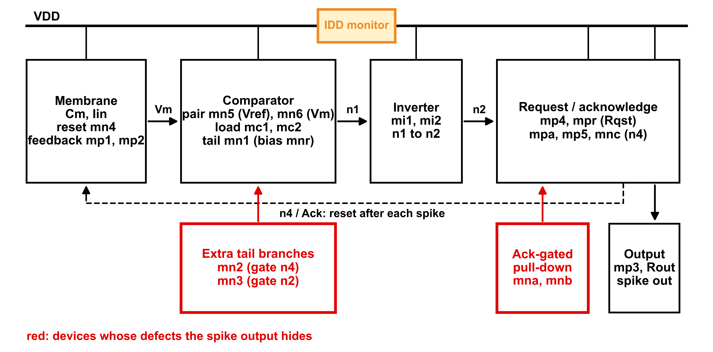

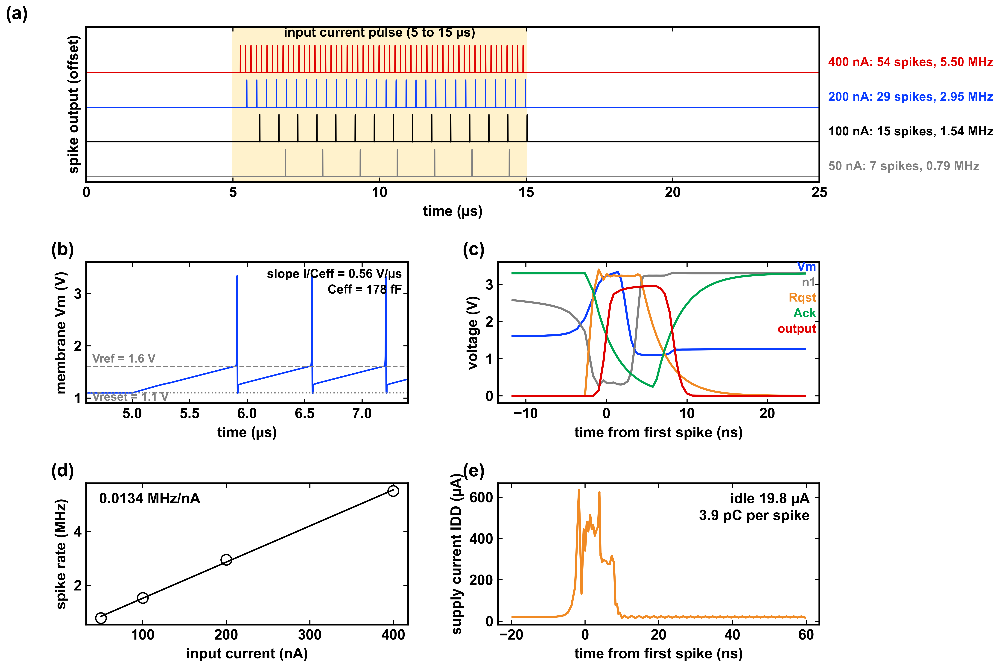

## 2. Defects and process variation

| | |
|---|---|
| Defects | 46: every transistor **stuck-on** (10 Ω drain–source) and **open-gate** (Esen et al., ITC 2016 model), plus membrane capacitor and output resistor ±50 % |
| Global variation | each die gets one process draw from the foundry's own statistical models (Monte Carlo, plus TT/SS/FF corner dies) |
| Local mismatch | per-transistor threshold shifts from the PDK's mismatch model |
| Stimulus | 10 µs current pulse at 50, 100, 200 and 400 nA on every neuron |
| Readouts | spike timing; membrane voltages; **supply charge and peak supply current**; internal nodes |

| Technology | Simulator | Independent neurons |
|---|---|---|
| GF180MCU (open PDK) | ngspice 41 | 49,840 (280 dies) |
| TSMC 65 nm | HSPICE | 60,000 (150 dies × 50 classes × 8 draws) |

Every random draw is seeded and logged, so each neuron can be regenerated exactly.

## 3. How the test decides

Neurons are split **by die** (60/20/20 % train/validation/test), so the test never
sees a die it was trained on. A gradient-boosted classifier scores each neuron, and
the threshold is set so that only **1 % of healthy neurons are rejected**. The figure
of merit is the share of defective neurons that slip through (the miss rate),
averaged over 6 random die splits.

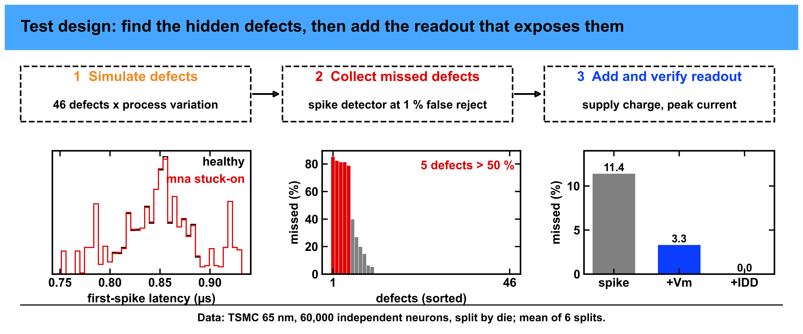

---

## 4. Results

### Detection by readout set (TSMC 65 nm, 60,000 neurons)

| Readouts used | Defective neurons missed |
|---|---|
| Spike timing only | 11.4 % ± 2.8 |
| + membrane voltage | 3.3 % ± 1.3 |
| **+ supply charge and peak current** | **0.0 % ± 0.0** |
| Supply readouts alone | 4.5 % ± 0.9 |

GF180 gives the same picture: 10.3 % missed with spikes only, 3.7 % with membrane
readouts.

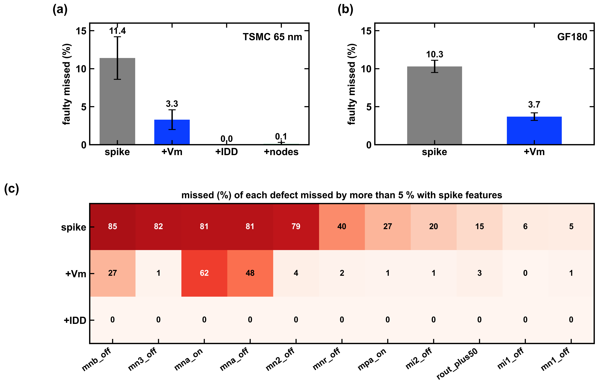

### Which defects hide, and why

Eleven of the 46 defects are missed more than 5 % of the time by a spike-only test.
The worst all sit in the **handshake/reset path**: the acknowledge-gated pull-down
(`mna`, `mnb`) and the extra comparator tail branches (`mn2`, `mn3`). The same devices
hide in both technologies.

| Defect | Missed: spikes | + membrane | + supply |
|---|---|---|---|
| `mnb` open gate | 85 % | 27 % | 0.0 % |
| `mn3` open gate | 82 % | 1.3 % | 0.0 % |
| `mna` stuck-on | 81 % | 62 % | 0.2 % |
| `mna` open gate | 81 % | 48 % | 0.0 % |
| `mn2` open gate | 79 % | 3.9 % | 0.0 % |

These devices conduct mainly *after* a spike, so a defect there changes the current
drawn per spike but hardly changes how the membrane charges: the spike period moves
by at most 1.8 %, while `mna` stuck-on raises the peak supply current by 17.1 % and
`mnb` open gate raises the charge per pulse by 76.3 %.

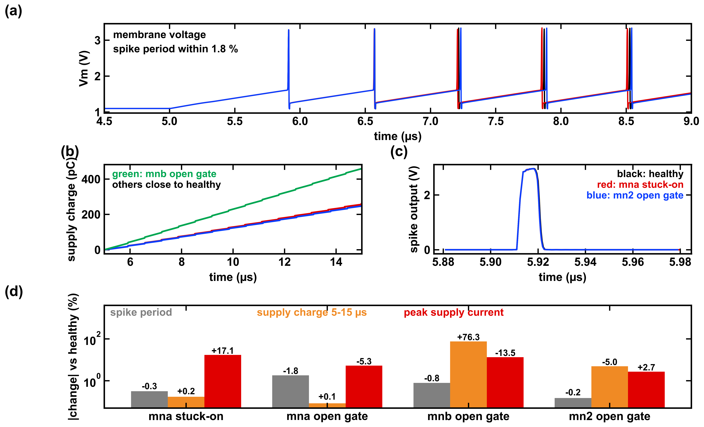

### A cheaper test

- **Noise:** supply readouts still miss 0.0 % with up to 2 % measurement noise
  (0.3 % at 5 %, 0.9 % at 10 %).
- **One pulse is enough:** a single 100 nA pulse with all readouts misses only 0.1 %.
- **Two-stage test:** score every neuron on spikes first and measure supply current
  only for the uncertain ones. With 10 % of neurons defective, measuring 11 % of
  neurons leaves 4.8 % missed, 20 % leaves 2.9 %, and 44 % leaves 0.7 %.

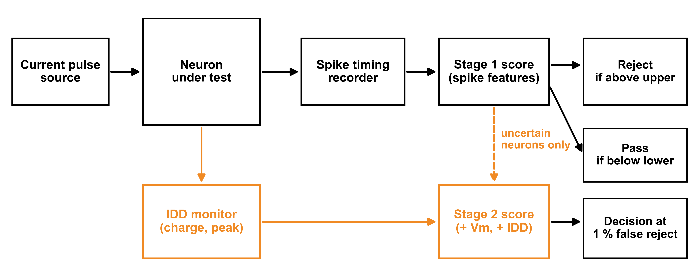
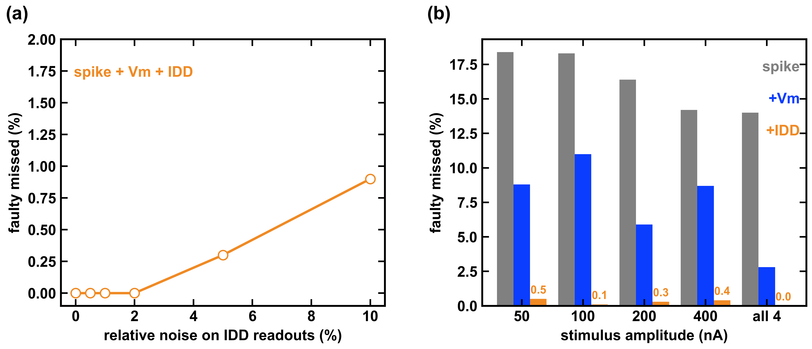
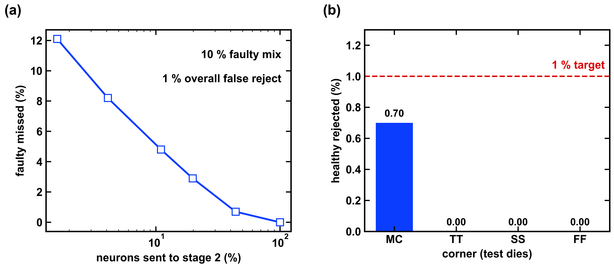

### Locating the defect

Identifying which of the 46 defects is present: **72.6 %** correct from spikes,
**91.3 %** with membrane readouts and **96.2 %** with supply readouts (top-3: 90.5 /
100 / 100 %). Only `mn1` stuck-on and `mn3` stuck-on cannot be told apart.

### Drift, readout loading and defect severity

- **Drift:** the smallest detectable `mn1` threshold drift falls from 89 mV
  (spikes + membrane) to 13 mV with supply readouts, and to 1.8 mV when a neuron is
  compared with its own earlier measurement.
- **Readout tap:** probing the membrane node adds 5 ns of spike delay per fF. A test
  trained without the tap rejects 75 % of good neurons at 25 fF; training with tap
  examples brings that to 2.5 %.
- **Severity:** shorts up to 1 kΩ are as detectable as 10 Ω; 1 MΩ shorts and weak
  partial opens are largely undetectable with any readout.

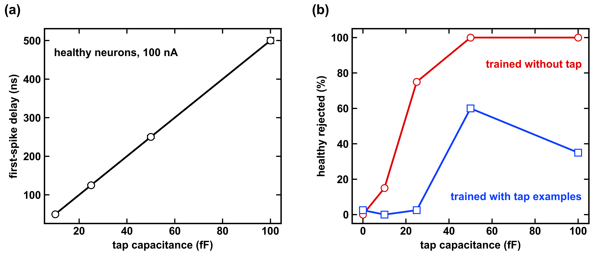
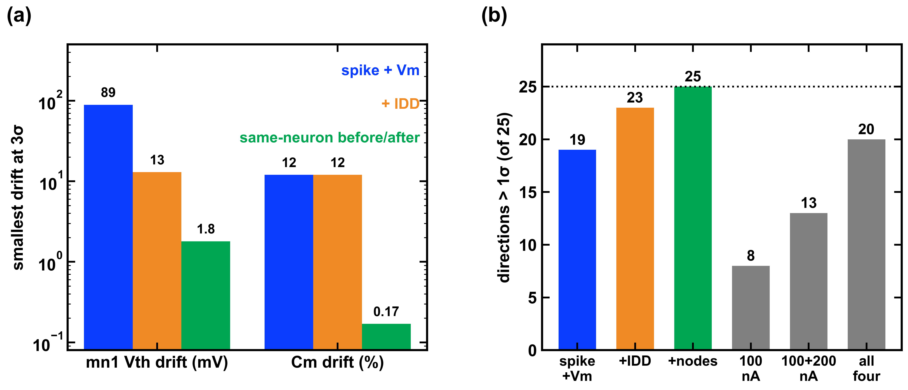
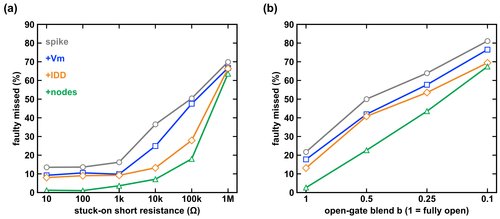

### What did not work

- Subtracting the median of neighbouring neurons on the same die made detection
  *worse* (10.3 % → 11.8 % missed).
- Hand-engineered features (ratios across amplitudes, latency fits) gave no gain.
- A test trained on one technology does not transfer to the other, even after
  recalibration: the *method* transfers, a trained model does not.

---

## 5. Data and code in this repository

| Path | Contents |
|---|---|
| `data/gf180/` | full GF180 dataset: readouts, every neuron's parameters and seeds, supply-current supplement, severity sweep |
| `code/` | GF180 generators, the circuit and defect definitions, every evaluation script |
| `results/` | output of every analysis, both technologies |
| `docs/` | methodology, circuit, data dictionary, provenance, detailed results, known issues, references |
| `examples/quickstart.py` | reproduces the GF180 headline in a few minutes |
| `figures/` | the figures above |

```bash
python examples/quickstart.py
```

This gives about 10.9 % / 3.9 % missed (spikes / + membrane, 3 die splits; the
6-split values are 10.3 % / 3.7 %).

**TSMC 65 nm data is not included.** It derives from a foundry model library
licensed to the institute; the TSMC numbers above are aggregate analysis results.
Scripts named `eval_*` without a `gf180_` prefix need that data to run.

## Limitations

- Simulation only; measurement noise is added afterwards. No silicon.
- One neuron topology, in two technologies.
- The acknowledge signal is an ideal delayed element, not transistors.
- Mostly catastrophic defects, plus a small graded-severity sweep.
- Drift and tap-loading groups are small (20 and 10 dies).

## License

All rights reserved. Contact the authors for reuse.
